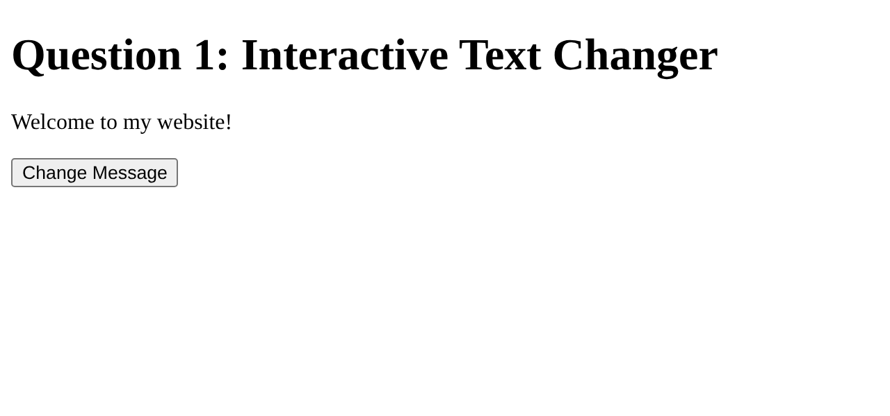
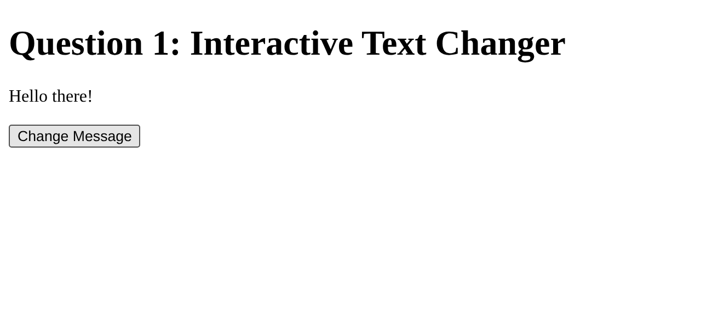
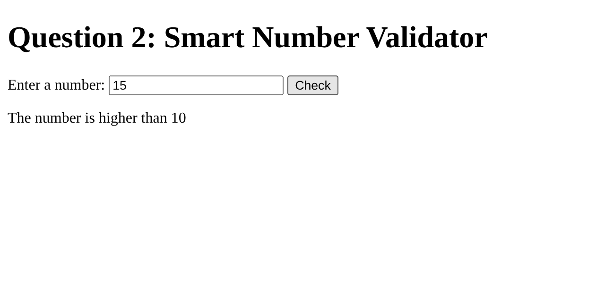
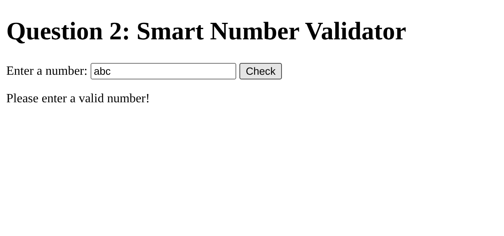
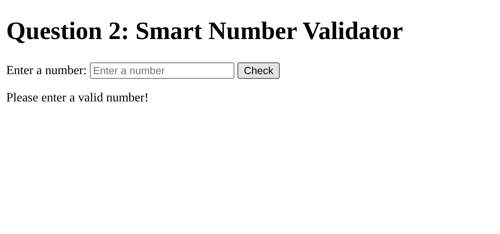
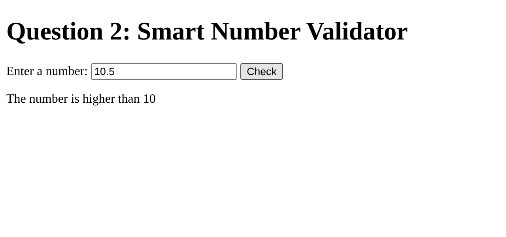
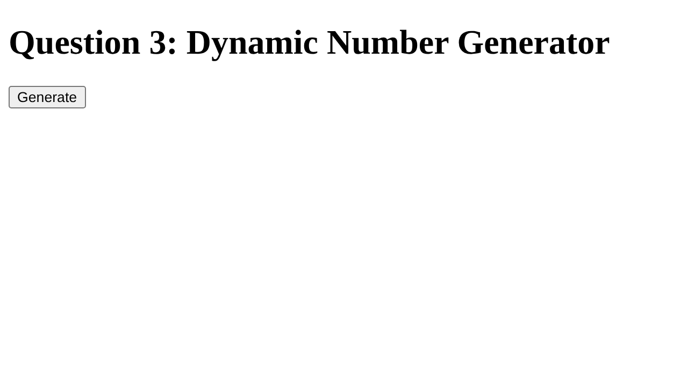
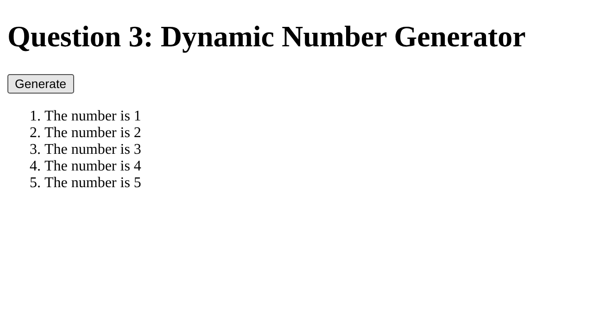

# BIC21203 Web Development — Lab 4a: Client-Side Scripting (JavaScript)

**Name:** Kirthetharan A/L Sehkar
**Student ID:** AI240016
**Faculty:** Faculty of Computer Science and Information Technology, UTHM

## Overview

This repository contains three small interactive web pages built with HTML5 and plain JavaScript (no external libraries). Each question is in its own folder with an `index.html` and an external `script.js` loaded with `defer`.

All three follow the same safe-coding practices required by the lab:

- Events are registered with `addEventListener()` instead of inline `onclick` attributes.
- All user-facing text is set with `textContent`; `innerHTML` is never used.
- Elements are selected with `document.getElementById()`.

## Repository structure

```
bic21203-lab4a-javascript/
├── Q1/            Interactive Text Changer
│   ├── index.html
│   └── script.js
├── Q2/            Smart Number Validator
│   ├── index.html
│   └── script.js
├── Q3/            Dynamic Number Generator
│   ├── index.html
│   └── script.js
├── screenshots/   Browser output evidence
└── README.md
```

## How to run

No installation or server is needed.

1. Clone or download this repository.
2. Open the folder of the question you want to run (`Q1`, `Q2` or `Q3`).
3. Double-click `index.html` to open it in a current desktop browser (Chrome, Edge or Firefox).

## Question 1 — Interactive Text Changer

**What it does:** The page shows "Welcome to my website!". Clicking **Change Message** replaces the text with "Hello there!".

**How it works:** The paragraph and button are selected with `getElementById()`. The function `changeMessage()` sets the paragraph's `textContent` to "Hello there!", and it is attached to the button with `addEventListener("click", changeMessage)`.

| Before click | After click |
|---|---|
|  |  |

## Question 2 — Smart Number Validator

**What it does:** The user types a value and clicks **Check**. The page displays whether the number is lower than, higher than or equal to 10, or asks for a valid number.

**How it works:** The function `checkInput()` reads the input and removes surrounding spaces with `trim()`. It converts the text with `Number()` and uses `Number.isFinite()` to reject empty or non-numeric input such as `abc`. An `if...else if...else` structure then compares the number with 10, and the message is shown in `#result` with `textContent`. Decimal values such as `10.5` are accepted.

| Input | Expected message |
|---|---|
| `5` | The number is lower than 10 |
| `10` | The number is equal to 10 |
| `15` | The number is higher than 10 |
| `abc` | Please enter a valid number! |
| *(empty)* | Please enter a valid number! |
| `10.5` | The number is higher than 10 |

| 5 | 10 | 15 |
|---|---|---|
|  |  |  |

| abc | Empty | 10.5 |
|---|---|---|
|  |  |  |

## Question 3 — Dynamic Number Generator

**What it does:** Clicking **Generate** displays an ordered list from "The number is 1" to "The number is 5". Clicking again does not duplicate the list.

**How it works:** The function `generateNumbers()` first clears the list with `replaceChildren()`. A `for` loop then runs from 1 through 5; each pass creates an `<li>` with `document.createElement()`, sets its text with `textContent` and appends it to `#numberList`.

| Before click | After first click | After repeated clicks |
|---|---|---|
|  |  |  |
